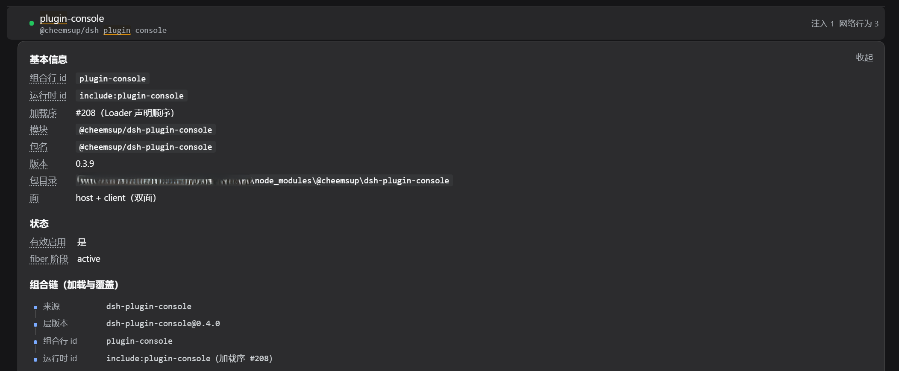
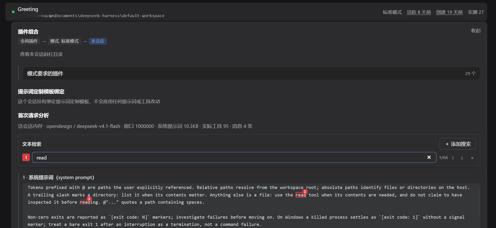
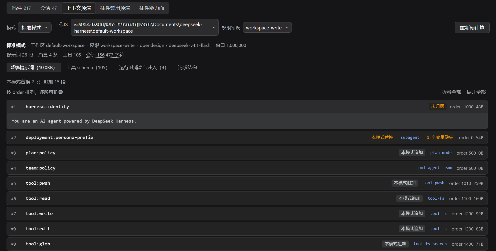
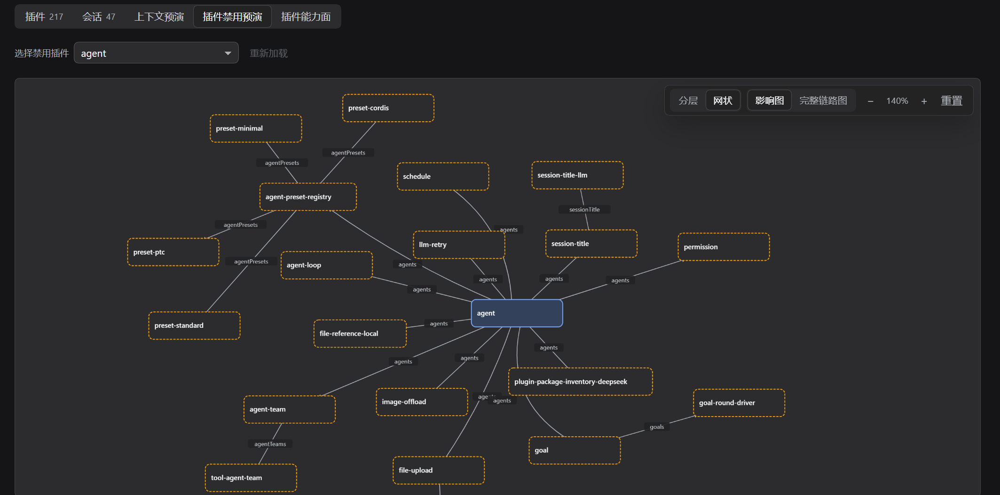
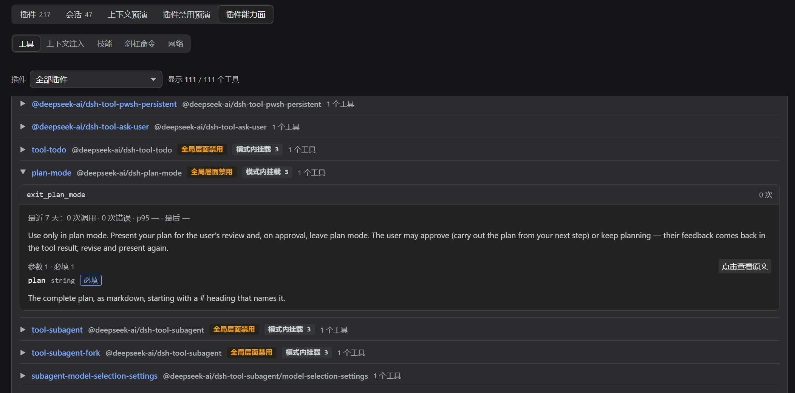
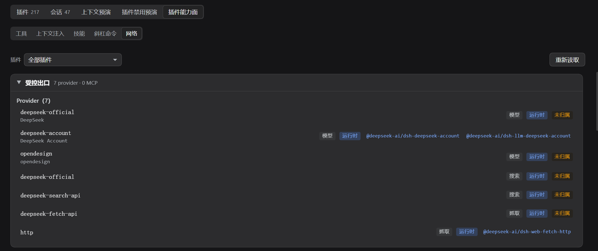

# dsh-plugin-console

[简体中文](README.md) · [English](README_en.md)

[](https://opensource.org/license/mit)

DeepSeek Harness（DSH）的侧边栏插件控制台：通过运行时对象分析以及原始文件扫描处理的方式获取关于插件、会话等分析信息并展示；同时提供模型上下文预演、插件禁用影响与配置覆盖关系的预演；提供对于首次请求的上下文定制功能。

欢迎提出建议、问题以及批评

## 功能

- **插件** — 浏览DSH装了哪些插件，查看启用状态、组合链、服务依赖、登记的行为、贡献的工具与上下文注入等，帮助掌控DSH内的插件行为和关系
- **插件能力面** — 汇总五类事实：工具、上下文注入（提示词段与运行时上下文）、技能目录、斜杠命令以及网络能力与连接，帮助查看每个能力的详情和来源
- **插件禁用预演** — 选择任一插件，预演禁用它会失去哪些工具、提示词段与运行时注入、展示 config 声明与生效值的差异，以及上下游插件的依赖图
- **会话** — 追踪每个会话中「全局插件 → 模式要求的插件 → 本会话」的来源链都带来了什么，可读首次请求的系统提示词、工具 schema 与消息注入等内容
- **上下文预演** — 指定模式、工作区与权限预设，查看新会话第一条消息发出前模型会收到的完整上下文构造
- **提示词定制** — 通过插件自管理规则文件的方式支撑起基于DSH不同模式标准上下文的定制改造，同时配套了对于模板的开关、继承、清理等完整生命周期控制手段

## 安装

```sh
# 从 npm 安装
# 也可直接在DSH内置插件添加中直接输入@cheemsup/dsh-plugin-console进行安装
dsh plugin --profile <profile> add @cheemsup/dsh-plugin-console

# 从 GitHub 安装
dsh plugin --profile <profile> add github:Cheemsup/dsh-plugin-console

# 从本地目录安装（开发）
dsh plugin --profile <profile> add file:<本目录绝对路径>
```

## 界面

### 插件页



*插件页：说明 DSH 内插件的基本信息、行为、依赖关系与能力贡献*

### 会话页



*会话页：展示了一个会话涉及的插件以及完整的首次请求上下文信息*

### 上下文预演页



*上下文预演页：回答「如果现在开一个新会话，第一条消息发出前模型会收到什么」，通过指定不同的工作区以及模式会带来不同的预演结果*

### 提示词定制页

*定制编辑器：选定工作区以及模式，则能够在此预演基础上进行提示词的定制以及开启会话*

### 插件禁用预演页



*插件禁用预演页：模拟禁用某插件后系统发生的变化，例如失去哪些提示词和工具、连带的影响链路传播情况*

### 插件能力面页





*插件能力面：详细查看DSH中存在的工具、SKILL、斜杠命令、网络行为的内容，同时对能力进行追踪溯源*

## 数据可信度

- **插件页** — 行与详情来自 Loader 运行时条目（fiber 阶段、服务供需、effect）、快照里的 bundle / patch 层与 config以及包源码扫描。注册表不记 owner，工具、注入、技能 / 命令名与网络行为靠扫描补归属，扫不到标「未归属」；行上的技能 / 命令读数优先取能力面 owner 摘要，取不到再退回源码扫描。
- **会话页** — 首次请求的系统提示词、工具 schema 与消息来自 session log；插件来源链由「全局插件 → 模式预设 → 本会话」的组合声明与会话记录推导。活会话能读运行时 scope；冷会话只有记录与模式要求，不能判断本进程实际挂载了什么。
- **上下文预演页** — 按选中的工作区、模式与权限预设，用同一份配置和文件重算出的预测；附件 / 图片、后续轮次与 goal / plan / schedule 等动态注入不在范围内，子 Agent 的首请求也不纳入。
- **提示词定制页** — 基线是上下文预演；模板、修订与会话绑定写在本插件的存储区，应用是把定制规则注册到目标 agent scope。定制只改模型上下文，不改变实际权限（工具禁用除外）。
- **插件禁用预演页** — 从 Loader 树、inject 声明与 patch 分层派生：子行级联、依赖链迭代到底
- **插件能力面页** — 工具与上下文注入读快照与源码扫描；技能 / 命令 / 网络按需读宿主（技能走 `ctx.skills`，命令优先活会话、冷会话按预设 scope 只读回退，网络读 provider / MCP / 路由注册与源码调用点）。网络调用点是静态证据，不证明请求发生过

## 已知边界

- **通用** — 需要宿主提供 `connection` 服务，否则只加载插件、不注册路由。
- **插件页** — 「能力贡献」来自源码扫描，名字存在不等于在当前会话里已注册；只有首请求装配里有落点的提示词能跳预演，其它作用域只展示注册点与源码。活动只统计工具调用（默认最近 7 天、最多 20 个会话，**实验性功能**），只提供服务或只监听事件的插件没有调用数。
- **会话页** — 冷会话没有 fiber：只显示记录与模式要求的插件，无法判断本进程实际挂载了什么。
- **上下文预演页** — 是预测不是记录；附件 / 图片、后续轮次与 goal / plan / schedule 等动态注入以及子 Agent 的首请求都不纳入。来源标签只说「可能的插件来源」，不区分同名碰撞。
- **提示词定制页** — 只影响模型上下文，不改变实际权限（工具禁用除外）；清理模板数据只删持久记录，运行中的会话会保留已注册内容，直到结束或 DSH 重启。
- **插件禁用预演页** — 派生计算，不执行禁用、也不模拟运行时卸载；「失去」只表示没有其他所有者，结论的语义是「禁用并重载 / 重启后」，已激活的插件可能在下一次重载前仍保留注册与工具。配置只展示声明与生效值，patch 合并语义未公开，原因一律标推断；bundle patch 读不到时会标注。
- **插件能力面页** — 不记录网络请求流水，源码调用点不证明请求发生过；不拦截 fetch、不读代理日志。斜杠目录只覆盖 host 命令 + user-invocable skill，client 侧贡献与客户端技能源只在浏览器里。会话未激活（或未指定）时命令目录回退不读会话 scope 里注册的命令，所有 scope 都读取不到再退源码扫描。

## 开发

架构与修改约束见 [CLAUDE.md](CLAUDE.md)，界面规范见
[docs/design-ui.md](docs/design-ui.md)

## 许可

MIT
