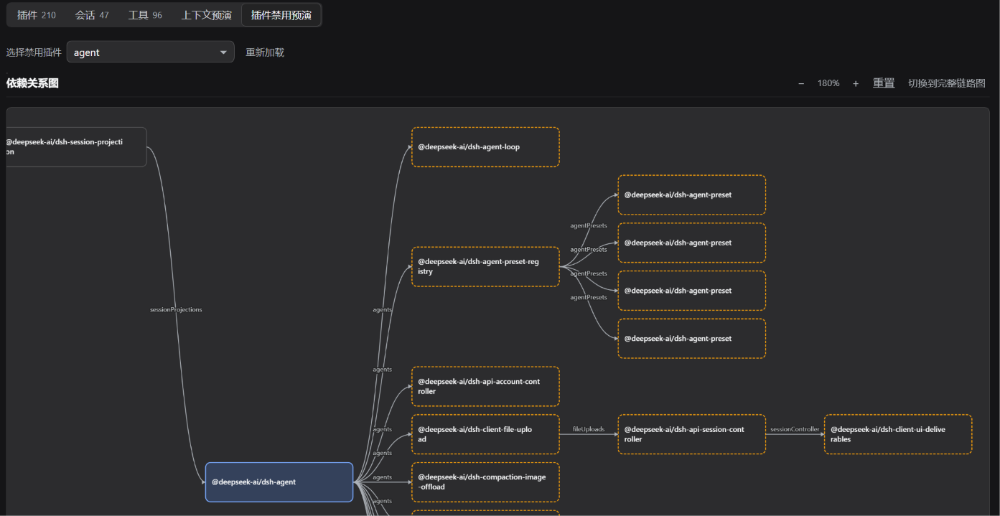

# dsh-plugin-console

[简体中文](README.md) · [English](README_en.md)

[](https://opensource.org/license/mit)

DeepSeek Harness（DSH）的侧边栏插件控制台：通过运行时对象分析以及原始文件扫描处理的方式获取关于插件、会话、工具等信息并通过页面向用户展示；同时提供模型上下文预演、插件禁用影响与配置覆盖关系的预演，以及相应的上下文定制功能

欢迎提出建议、问题以及批评

## 功能

- **插件** — 浏览这台机器装了哪些插件，查看启用状态、组合链、服务依赖、登记的行为、贡献的工具与提示词段等，帮助掌控DSH内的插件行为和关系
- **会话** — 追踪「全局插件 → 模式要求的插件 → 本会话」的来源链，可读首次请求的系统提示词、工具 schema 与消息注入等内容
- **工具** — 可按注册的插件分组查看工具，也可以看每个模式的预设工具集，帮助观察DSH中每个工具的来源以及详细信息
- **上下文预演** — 指定模式、工作区与权限预设，查看新会话第一条消息发出前模型会收到的完整上下文构造
- **提示词定制模板** — 通过插件自管理规则文件的方式支撑起基于DSH标准模型上下文的定制改造；同时配套了对于模板的开关、继承、清理等完整生命周期控制手段
- **能力面** — 模型工具之外的三类事实：按工作区与模式浏览技能目录（文件位置、来源层级、使用方式、完整正文）、查看斜杠命令目录（host 命令、内置别名、技能入口）、以及网络能力与连接（LLM / web provider、MCP 状态、入站路由声明）
- **插件禁用预演** — 选择任一插件，预演禁用它会失去哪些工具、提示词段与运行时注入、展示 config 声明与生效值的差异，以及上下游插件的依赖图；依赖图可按层次分层查看，也可切换成网状布局看连接密度，点击节点或边可高亮经过它的整条依赖路径，右键节点可跳到插件页

## 安装

```sh
# 从 npm 安装
# 也可直接在DSH内置添加插件直接输入@cheemsup/dsh-plugin-console进行安装
dsh plugin --profile <profile> add @cheemsup/dsh-plugin-console

# 从 GitHub 安装
dsh plugin --profile <profile> add github:Cheemsup/dsh-plugin-console

# 从本地目录安装（开发）
dsh plugin --profile <profile> add file:<本目录绝对路径>
```

## 界面

### 插件页


*图 1 · 插件页：说明了DSH内插件的信息、行为、依赖关系等信息*

插件详情把贡献分成「工具 / 提示词段 / 运行时上下文」三组：只有当前首请求装配里有落点的名字
能一键跳到上下文预演；子代理 / 会话 / 条件作用域的名字会就地展开注册点、接收者与按需源码片段。

### 会话页


*图 2 · 会话页：展示了一个会话涉及的插件以及完整的首次请求上下文信息*

### 工具页


*图 3 · 工具页：回答「模型能看到哪些工具、谁给的」。来源来自扫描插件包源码，提供友好阅读方式*

### 上下文预演


*图 4 · 上下文预演页：回答「如果现在开一个新会话，第一条消息发出前模型会收到什么」，通过指定不同的工作区以及模式会带来不同的预演结果*

### 提示词定制模板


*图 5 · 定制编辑器：选定工作区以及模式，则能够在此预演基础上进行提示词的定制以及开启会话*

### 能力面

能力面把「模型工具之外还提供了什么」集中到一页：

- **技能**：按工作区 + 模式读取 `ctx.skills` 目录，显示文件位置、source、provider、使用方式与发现完整性；正文按需读取，完整显示不截断。
- **斜杠命令**：按工作区挑选会话（含未运行的会话；未归属工作区的会话兜底进默认工作区并标「未归属」），活会话读 `commands.list(agent)`；会话已结束或没有指定会话时只读预设 scope，再退源码扫描。同时列出 user-invocable skill 入口；浏览器侧注册的命令贡献不在宿主侧，界面把它收在来源标签的悬停说明里。
- **网络**：LLM / web 搜索 / web 抓取 provider、MCP server 的连接状态、入站路由声明，以及源码里识别到的网络调用点（fetch / axios / node:http / WebSocket / 配置键）；不展示 endpoint、headers、env 等配置值，源码端点只保留去掉凭据与查询串的字面量。

### 插件禁用预演



*图 6 · 插件禁用预演页：模拟禁用某插件后系统发生的变化，例如失去哪些提示词和工具、连带的影响链路传播情况*

## 数据可信度

- **运行时事实**：插件条目与状态、工具与提示词注册、会话日志，直接读宿主。
- **推导**：工作区、权限、指令文件、skill 目录与时间快照，用同一份配置和文件重算。
- **源码归属**：注册表不记录工具、提示词段、命令、技能与 provider 是谁注册的，因此扫描插件包源码补齐。
- **能力面**：技能与命令来自运行时注册表；命令的 `definitionId`、技能的 `provider` 是包级事实，匹配不到时才退回源码扫描。入站路由来自注册时写入的 effect label 与源码里的 path 字面量，两者分别标注。
- **作用域推断**：注册点带文件、行号与接收者；`childCtx` / `scope` 等接收者只用于推断「其它作用域」，不写成运行时结论。
- **文件事实**：bundle / profile / home 的 patch 文件与其中的 config 子树；文件读不到或写法不受支持时标注原因。
- **未知 / 不可用**：缺少输入或宿主没有暴露这项能力时如实标注，推导不会被写成实测。

## 已知边界

- 需要宿主提供 `connection` 服务，否则只加载插件、不注册路由。
- 冷会话没有 fiber：只显示记录与模式要求的插件，无法判断本进程实际挂载了什么。
- 上下文预演是预测，不是记录；附件 / 图片、后续轮次与 goal / plan / schedule 等动态注入不在
  范围内，子 Agent 的首请求也不纳入。
- 插件页的「提示词段 / 运行时上下文」来自包源码扫描，名字存在不等于在当前会话里已注册。
  插件详情里的每条提示词贡献都可以就地展开查看注入文本，再通过二级展开查看「何时展示、
  注册点与源码」；只有当前模式的首请求装配里有落点的贡献才额外提供「预演」动作。
  子代理 / 会话 / 条件作用域的贡献只展示源码证据，不提供预演动作。名字级来源在本机唯一、
  注册点全在本作用域且不是模板时标「唯一来源」。上下文预演页的来源标签统一为
  「可能的插件来源，点击跳转查看」，不在标签上区分同名碰撞。
  文本与源码片段都是静态扫描事实，不是模型实际收到的正文。
- 能力面不记录网络请求流水：只展示 provider 注册表、MCP 连接状态、路由声明与源码静态扫描到的调用点（不代表请求真的发生过），不拦截 fetch、不读代理日志。斜杠目录只覆盖 host 命令 + user-invocable skill；client 侧贡献（`ui-commands`）与客户端技能源只在浏览器里，宿主侧不可见。
- 会话已结束（或没有指定会话）时没有 Agent：命令目录按该会话记录的模式 + 选中工作区做预设 scope 只读回退，会话 scope 里注册的命令读不到，页面会标明这是回退；scope 取不到时再退源码扫描。
- 活动只统计工具型贡献，默认最近 7 天、最多 20 个会话（实验性功能）；只提供服务或只监听事件的插件没有调用数。
- 插件禁用预演是派生计算，不执行禁用、也不模拟运行时卸载；「失去」只表示没有其他所有者。依赖链按 inject 声明推导到不动点，语义是禁用并重载/重启后，已激活的插件可能在下一次重载前仍保留注册与工具。配置分层只展示 patch 文件声明与生效值，patch 的合并语义未公开，诊断不推断原因；内置组合包或缺少 `pluginPackages` 时 bundle patch 不可读，会如实标注。
- 提示词定制**只影响模型上下文，不改变实际权限**，工具禁用除外。
- 清理模板数据只删持久记录，运行中的会话会一直保留已注册内容，直到结束或 DSH 重启。

## 开发

架构与修改约束见 [CLAUDE.md](CLAUDE.md)，界面规范见
[docs/design-ui.md](docs/design-ui.md)，可能的下一步方向见 [docs/next-direction.md](docs/next-direction.md)。

## 许可

MIT
