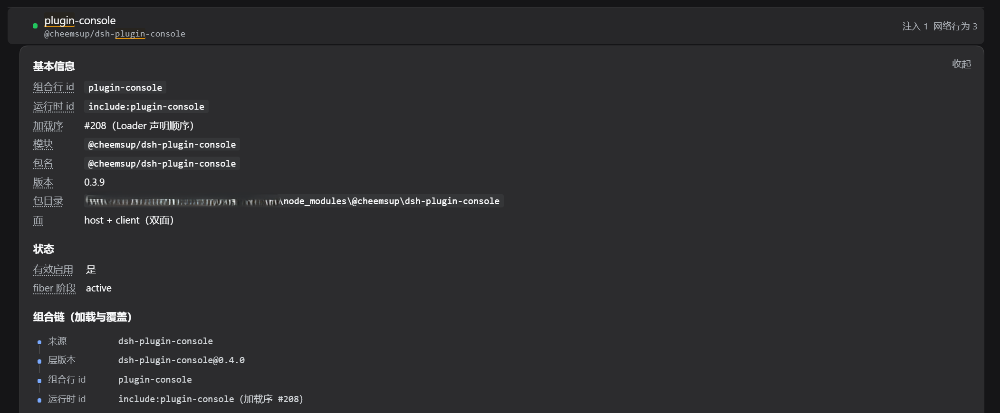
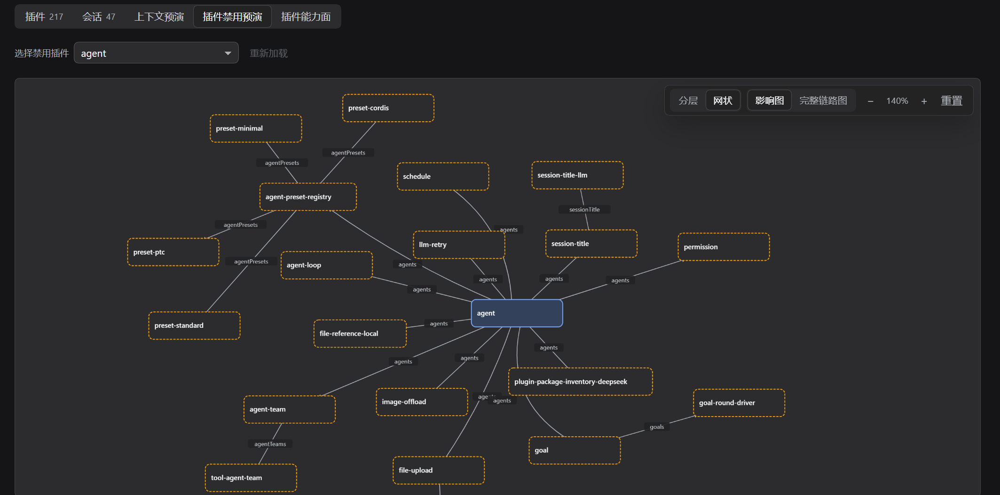
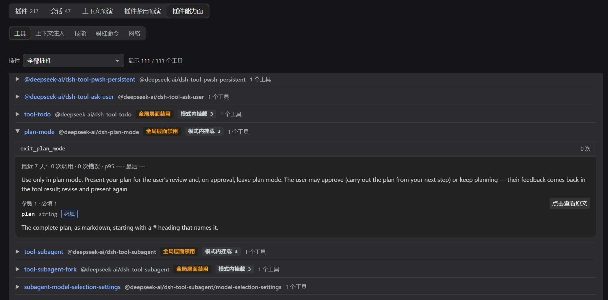

# dsh-plugin-console

[简体中文](README.md) · [English](README_en.md)

[](https://opensource.org/license/mit)

A sidebar plugin console for DeepSeek Harness (DSH): it gathers analysis information about
plugins, sessions, and more through runtime object analysis and raw file scanning, and presents it
in the panel. It also provides model-context preview, previews of plugin-disable impact and config
overrides, and context customization for the first request.

Suggestions, questions, and criticism are welcome.

## Features

- **Plugins** — browse which plugins are installed in DSH; inspect enabled status, composition
  chain, service dependencies, registered effects, contributed tools and context injections, and
  understand plugin behaviour and relationships inside DSH.
- **Capability surface** — five kinds of facts in one place: tools, context injections (prompt
  sections and runtime contexts), the skills catalog, slash commands, and network capabilities and
  connections, with each capability's details and source.
- **Plugin disable preview** — pick any plugin and preview which tools, prompt sections, and
  runtime injections would be lost, how the declared config differs from the effective value, and
  the dependency graph of upstream/downstream plugins.
- **Sessions** — trace what each session's source chain (global plugins → preset-required plugins
  → this session) brings, and read the first request's system prompt, tool schemas, injected
  messages, and more.
- **Context preview** — pick a mode, workspace, and permission preset to see the complete context
  the model will receive before the first message of a new session is sent.
- **Prompt customization** — a rule file managed by the plugin enables customization on top of
  DSH's standard context for different modes, with a complete lifecycle for switching,
  inheritance, and cleanup.

## Install

```sh
# From npm
# You can also add it from DSH's built-in plugin list by entering @cheemsup/dsh-plugin-console
dsh plugin --profile <profile> add @cheemsup/dsh-plugin-console

# From GitHub
dsh plugin --profile <profile> add github:Cheemsup/dsh-plugin-console

# From a local checkout (development)
dsh plugin --profile <profile> add file:<absolute path to this repo>
```

## Screens

### Plugins



*The Plugins page: basic information, behavior, dependencies, and capability contributions of
plugins inside DSH.*

### Sessions


*The Sessions page: the plugins involved in a session and the complete first-request context.*

### Context preview


*The context preview page: answers "what will the model receive before the first message if a new
session is started now"; different workspaces and modes produce different preview results.*

### Prompt customization

*The editor: after choosing a workspace and mode, customize the prompt on top of the preview and
start a session.*

### Plugin disable preview



*The plugin disable preview page: simulates what changes after disabling a plugin, such as which
prompts and tools are lost and how the impact propagates along dependency chains.*

### Capability surface




*The capability surface: inspect tools, skills, slash commands, and network behaviour in DSH, and
trace where each capability comes from.*

## Data confidence

- **Plugins** — Rows and details come from runtime Loader entries (fiber phase, service requires/provides, effects), the snapshot's bundle/patch layers and config, and package source scanning. The registry does not record owners, so tools, injections, skill/command names, and network behaviour are attributed by scanning and marked "unowned" when nothing matches; skill and command readings prefer the capability surface's owner summary and fall back to the source scan.
- **Sessions** — The first request's system prompt, tool schemas, and messages come from the session log; the plugin source chain is inferred from the global → preset → session composition declarations and the session record. Live sessions expose the runtime scope; cold sessions show only records and the preset's requirements, not what this process actually mounted.
- **Context preview** — A prediction recomputed from the same config and files under the selected workspace, mode, and permission preset; attachments/images, later turns, dynamic injections such as goal / plan / schedule, and subagent first requests are out of scope.
- **Prompt customization** — The baseline is the context preview; templates, revisions, and session bindings live in this plugin's storage area, and applying registers the customization rules into the target agent scope. It changes model context only, not actual permissions, except for disabled tools.
- **Plugin disable preview** — Derived from the Loader tree, inject declarations, and patch layers: child rows cascade and dependency chains iterate to completion.
- **Capability surface** — Tools and context injections read the snapshot plus source scanning; skills, commands, and network are fetched from the host on demand (skills via `ctx.skills`, commands from a live session first with a read-only preset-scope fallback for cold sessions, network from provider/MCP/route registries and source call sites). Source call sites are static evidence and do not prove a request happened.

## Known limits

- **General** — Requires the host's `connection` service; without it the plugin loads but registers no routes.
- **Plugins** — "Capability contributions" come from source scanning: a name existing there does not mean it is registered in the current session. Only prompt contributions with a target in the first-request assembly get a preview action; other scopes show registration sites and source only. Activity counts tool calls only (last 7 days, at most 20 sessions by default, **experimental**); plugins that only provide services or listen to events have no call counts.
- **Sessions** — Cold sessions have no fiber: they show recorded facts and the preset's plugins, not what this process actually mounted.
- **Context preview** — A prediction, not a record. Attachments/images, later turns, dynamic injections such as goal / plan / schedule, and subagent first requests are out of scope. Owner tags read "possible plugin source" and do not distinguish name collisions.
- **Prompt customization** — Affects model context only, never actual permissions (except disabled tools). Clearing template data removes persisted records only; running sessions keep what they registered until they end or DSH restarts.
- **Plugin disable preview** — Derived; it does not disable anything or simulate an unload, and "lost" only means no other owner. The result describes the state after a reload/restart, so already-active plugins may keep their registrations until then. Config layers show declarations and effective values only; patch merge semantics are not public, so causes are labelled inferred, and an unreadable bundle patch is marked.
- **Capability surface** — No network request traffic is recorded: source call sites do not prove a request happened, and fetch is not intercepted. The slash directory covers host commands plus user-invocable skills; client-side contributions and client skill sources exist only in the browser. When the session is inactive (or none is specified), the command-directory fallback does not read commands registered in the session scope; if no scope can be read at all, it falls back to source scanning.

## Development

Architecture and constraints live in [CLAUDE.md](CLAUDE.md); UI rules in
[docs/design-ui.md](docs/design-ui.md).

## License

MIT
