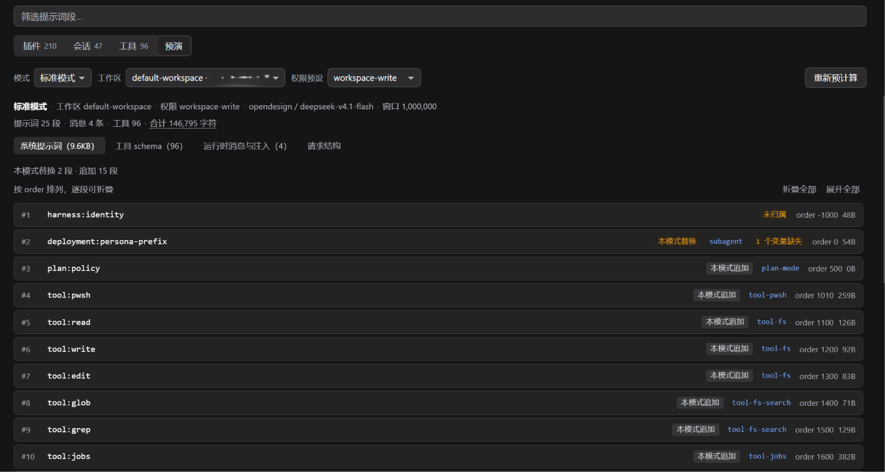
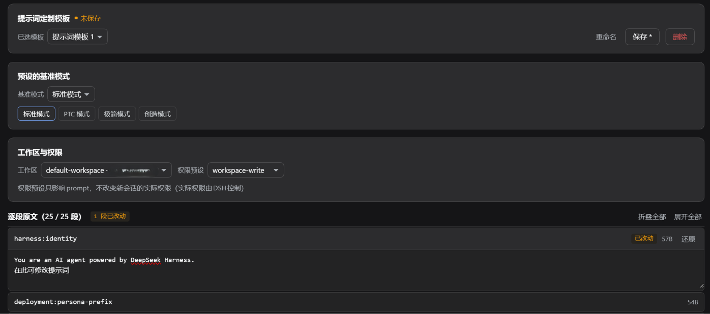

# dsh-plugin-console

[简体中文](README.md) · [English](README_en.md)

[](https://opensource.org/license/mit)

A sidebar plugin console for DeepSeek Harness (DSH). It gathers plugin, session, and tool
information through runtime object analysis and raw source-file scanning, and presents it in the panel.
It also provides a first-request model-context preview and matching context customization.

## Features

- **Plugins** — browse the plugins installed on this machine; inspect enabled status, composition
  chain, service dependencies, registered effects, contributed tools and prompt sections, and
  understand how plugins behave and relate inside DSH.
- **Sessions** — follow the source chain from global plugins to the preset's plugins to this
  session, and read the first request's system prompt, tool schemas, injected messages, and more.
- **Tools** — view tools grouped by the plugin that registers them, or each mode's preset tool set,
  to trace where every tool comes from and see its details.
- **First-request preview** — pick a mode, workspace, and permission preset to see the complete
  context the model will receive before the first message of a new session is sent.
- **Prompt customization templates** — a rule file managed by the plugin enables customization on
  top of DSH's standard model context, with a complete lifecycle for switching, inheritance, and
  cleanup.

## Install

```sh
# From npm
dsh plugin --profile <profile> add @cheemsup/dsh-plugin-console

# From GitHub
dsh plugin --profile <profile> add github:Cheemsup/dsh-plugin-console

# From a local checkout (development)
dsh plugin --profile <profile> add file:<absolute path to this repo>
```

## Screens

### Plugins


*Figure 1 · The Plugins page shows plugin information, behavior, dependencies, and relationships
inside DSH.*

### Sessions


*Figure 2 · The Sessions page shows the plugins involved in a session and the complete
first-request context.*

### Tools


*Figure 3 · The Tools page answers "which tools the model can see, and who provided them." Sources
come from scanning plugin package source, presented in a readable form.*

### First-request preview



*Figure 4 · The preview page answers "if I started a new session now, what would the model receive
before my first message." Different workspaces and modes produce different preview results.*

### Prompt customization templates



*Figure 5 · The editor: after choosing a workspace and mode, customize the prompt on top of the
preview and start a session.*

## Data confidence

- **Runtime facts**: plugin entries and status, tool and prompt registrations, and session logs are
  read directly from the host.
- **Derived**: workspace, permissions, instruction files, skill catalog, and time snapshots are
  recomputed from the same config and files.
- **Source attribution**: the registry does not record who registered a tool or prompt section, so
  plugin source is scanned to fill that in.
- **Unknown / unavailable**: stated honestly when input is missing or the host exposes no read path;
  derived values are never presented as measured.

## Known limits

- Requires the host's `connection` service; without it the plugin loads but registers no routes.
- Cold sessions have no fiber: they show recorded facts and the preset's plugins, but not what this
  process actually mounted.
- The first-request preview is a prediction, not a record. Attachments/images, later turns, and
  dynamic injections such as goal / plan / schedule are out of scope; subagent first requests are not
  included.
- Activity covers tool contributions only, over the last 7 days and at most 20 sessions
  (experimental). Plugins that only provide services or listen to events have no call counts.
- Prompt customization **only affects model context, not actual permissions**, except for disabling
  tools.
- Clearing template data removes persisted records only; running sessions keep what they registered
  until they end or DSH restarts.

## Development

Architecture and constraints live in [CLAUDE.md](CLAUDE.md); UI rules in
[docs/design-ui.md](docs/design-ui.md); possible next steps in [docs/next-direction.md](docs/next-direction.md).

## License

MIT
